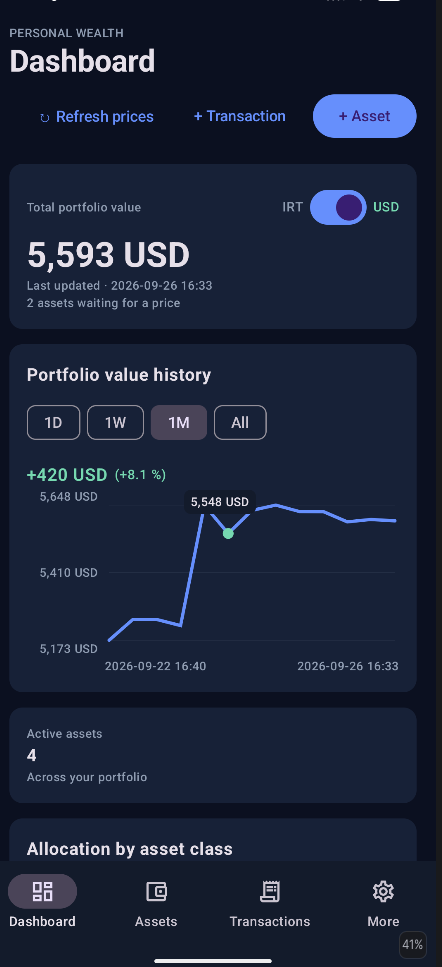

# Folio

Folio is a local-first Android app for tracking a personal investment portfolio. It is designed for portfolios that span crypto, Iranian and global equities, cash, precious metals, fixed income, and manually priced assets—without requiring an account or cloud service.

All portfolio records are stored in a Room/SQLite database on the device. Internet access is used only to look up instruments and refresh market prices; previously saved prices, valuations, and portfolio data remain available offline.

<p align="center">
  
</p>

## What it does

- Tracks assets across these classes: fixed income, US dollar, crypto, Iranian stock, global stock, gold, silver, and manual assets.
- Records buy and sell transactions, including quantity, optional unit price and fee, currency, location, and notes.
- Calculates holdings from the transaction ledger and prevents edits that would create a negative historical balance.
- Calculates weighted-average cost basis: buy fees are included; selling does not change the average cost until the holding reaches zero.
- Organizes assets with tags and storage locations such as exchanges, wallets, or physical holdings.
- Shows portfolio totals and allocation by asset class in both IRT and USD/USDT equivalents.
- Saves valuation snapshots and displays an interactive portfolio-history chart for 1 day, 1 week, 1 month, or all time.
- Supports manual prices as well as market-priced assets, with cached quotes available offline.
- Offers Persian and English interfaces, including RTL-aware Persian financial notation.

## Price providers

Market-priced assets can be searched and refreshed from public provider endpoints:

| Provider | Typical use |
| --- | --- |
| Nobitex | Crypto markets and the USDT/IRT conversion rate |
| Aban Tether | Crypto assets quoted in IRT |
| TSETMC | Iranian equities |
| Rahavard | Precious metals and supported market listings |

Opening the app or choosing Refresh in the dashboard requests a best-effort one-time update. While at least one home-screen widget is installed, Folio also schedules a network-connected refresh on a six-hour interval. The widgets and dashboard share the same serialized refresh operation. Failed provider calls preserve saved prices, and provider responses may change or become unavailable; manual pricing remains available as a fallback. No provider credentials are embedded in the app.

## Home-screen widgets

Folio provides two independently configured home-screen widgets:

- The portfolio widget shows a local portfolio total and allocation by asset type. Its hide-total control masks monetary values for that widget while keeping allocation labels and percentages visible.
- The favorite-price widget shows one market selected from Nobitex, Aban Tether, TSETMC, or Rahavard. A favorite can be any identifier supported by those providers, including a market that is not in the portfolio. Selecting one does not create or change a portfolio asset or transaction.

Widget settings and quote caches are stored on the device. Prices use the provider's quoted currency; IRT quotes are displayed in toman using Folio's existing unit handling. Without a network connection, a widget keeps its last successful quote and quote time and marks it stale or refresh-failed when applicable. Before any successful quote is cached, it shows an unavailable state instead of zero. Use the widget's Configure action to change its selection and Refresh action to request an immediate update.

## Privacy and data

- No account, server, WebView, or cloud database is required.
- Portfolio data and cached prices live in local SQLite storage on the device.
- The app requests `INTERNET` solely for optional instrument search and price refresh.
- Android system backup is enabled. Folio does not currently provide a custom JSON import/export workflow.

## Build

### Requirements

- Android Studio with JDK 24, matching `gradle/gradle-daemon-jvm.properties`
- Android SDK 35
- An Android 9 (API 28) or newer device/emulator

AGP requires at least JDK 17; this project's Gradle daemon selects JDK 24.
Java and Kotlin bytecode still target Java 11. CI and command-line builds
should make JDK 24 available to Gradle.

### Run from Android Studio

1. Open this repository in Android Studio.
2. Allow Gradle to sync.
3. Select an Android 9+ device or emulator.
4. Run the `app` configuration.

### Build from the command line

```bash
./gradlew :app:assembleDebug
```

The debug APK is produced under `app/build/outputs/apk/debug/`.

Release builds use optimized R8 defaults and the project rules in
`app/src/main/keepRules/rules.keep`. Room exports the current database schema
to `app/schemas/`; retain these files in version control when the schema changes.
Schemas for database versions 1 and 2 were not exported by earlier releases.

## Architecture

Folio is a native Kotlin application built with Jetpack Compose. Its core layers are:

| Layer | Responsibility |
| --- | --- |
| `presentation/` | Compose screens, navigation, language selection, view-model state, and Glance widgets |
| `data/local/` | Room entities, DAOs, migrations, and local persistence |
| `data/` | Portfolio repository and dashboard/history aggregation |
| `data/widget/` | Room-backed widget settings, quote cache, and portfolio snapshot calculation |
| `domain/` | Holdings, cost basis, pricing, currency conversion, and valuation rules |
| `data/network/` | Shared provider quote client, serialized refresh operation, and WorkManager scheduling |

The `assetsDashboard/` directory contains the earlier Django implementation retained as migration/reference material; the Android app does not depend on it at runtime.

## Tests

Run local unit tests with:

```bash
./gradlew :app:testDebugUnitTest
```

The test suite covers the core portfolio calculations and provider response parsers.

## Notes

Folio is a personal tracking tool, not financial advice. Market data is best-effort and should be verified before making financial decisions.
